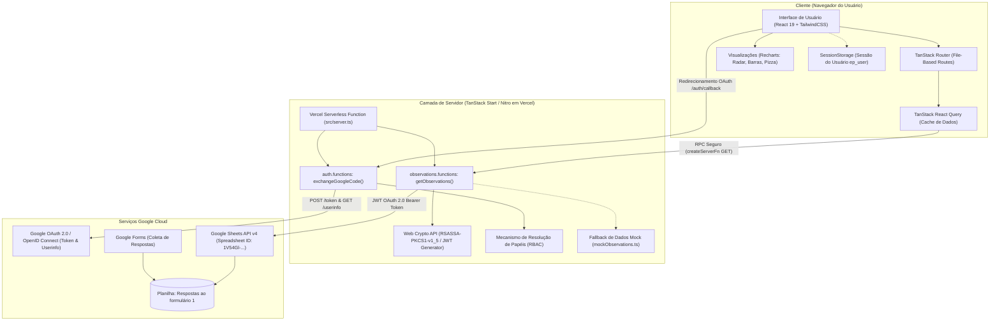
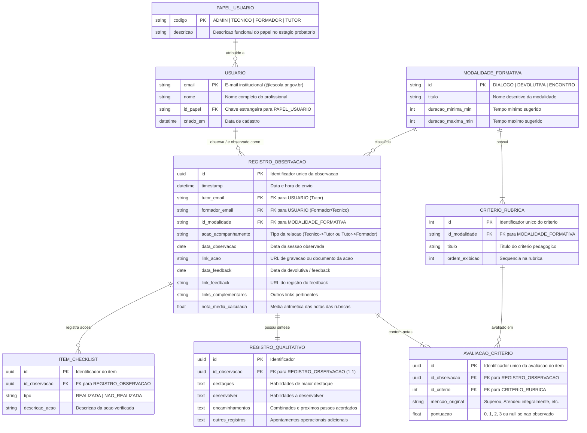
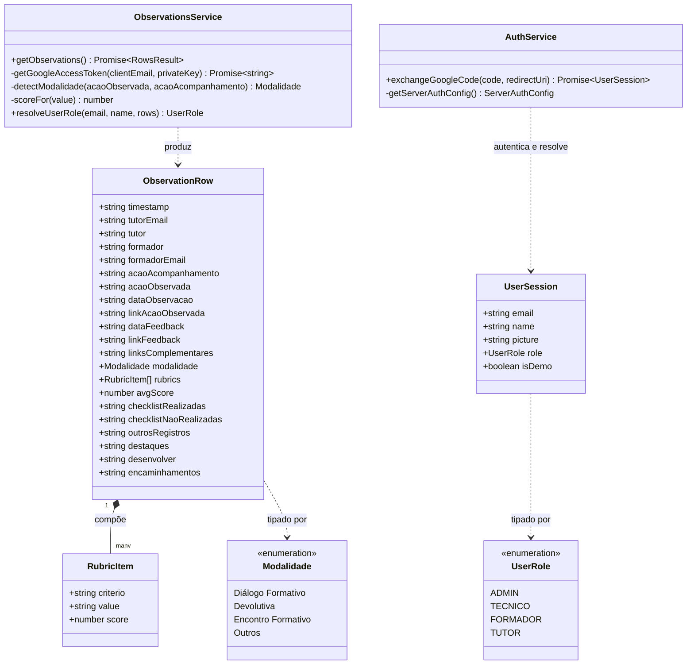
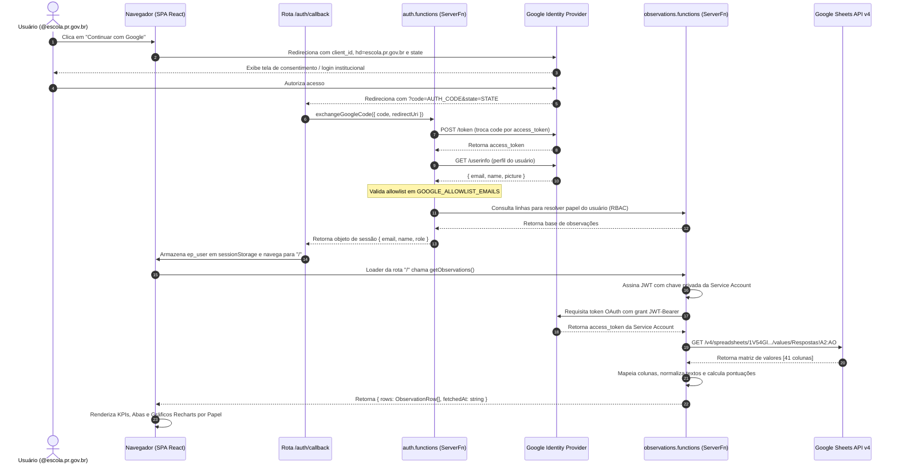
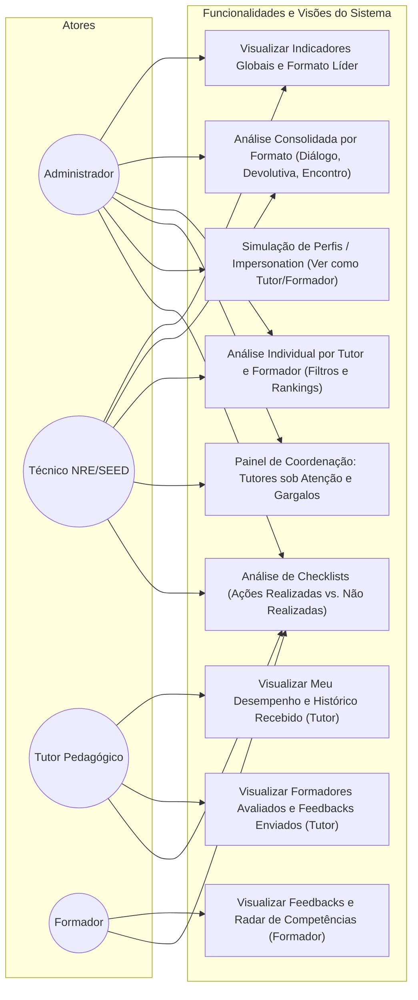

# Documentação Técnica e Arquitetural — Tutor Insights (Painel Estágio Probatório)

**Sistema de Acompanhamento e Observação Formativa do Estágio Probatório — SEED-PR**

---

## 1. Visão Geral do Sistema

O **Tutor Insights** é uma aplicação web fullstack com renderização no servidor (SSR) voltada à gestão pedagógica e monitoramento das práticas de tutoria e formação continuada da **Secretaria de Estado da Educação do Paraná (SEED-PR)**.

O objetivo do sistema é consolidar, mensurar e apresentar visualmente as avaliações e registros qualitativos gerados durante o programa de acompanhamento do estágio probatório. O sistema processa fluxos bidirecionais de observação:
1. **Técnicos (NRE/SEED)** observando e avaliando **Tutores Pedagógicos**.
2. **Tutores Pedagógicos** acompanhando e avaliando **Formadores**.
3. **Coordenação Pedagógica / Administradores** auditando o programa, identificando tutores sob atenção e gargalos de formação.

---

## 2. Arquitetura de Software e Tecnologias

A aplicação utiliza uma arquitetura moderna baseada no ecossistema TanStack:

| Camada | Tecnologia | Propósito |
| :--- | :--- | :--- |
| **Framework Fullstack** | [TanStack Start](https://tanstack.com/start) (`@tanstack/react-start`) | Roteamento file-based, SSR e Server Functions (`createServerFn`). |
| **Engine de Execução** | [Nitro](https://nitro.unjs.io/) (`nitropack`) | Engine de build e runtime universal com preset de implantação para Vercel. |
| **Biblioteca de UI** | [React 19](https://react.dev/) + [TypeScript 5.8](https://www.typescriptlang.org/) | Construção de componentes e tipagem estática ponta a ponta. |
| **Estilização** | [Tailwind CSS v4](https://tailwindcss.com/) + Radix UI + CSS Modules | Design system institucional customizado com paleta oficial da SEED-PR. |
| **Gráficos e Dashboards** | [Recharts](https://recharts.org/) | Gráficos de barras empilhadas, pizza/donut e radar de competências. |
| **Gerenciamento de Estado de Dados** | [TanStack React Query v5](https://tanstack.com/query) | Cache assíncrono com `staleTime`, pré-carregamento em loaders e suspensão. |
| **Roteamento e Navegação** | [TanStack Router v1](https://tanstack.com/router) | Roteamento seguro orientado a tipos com suporte a layouts e rotas aninhadas. |
| **Autenticação** | Google OAuth 2.0 (OpenID Connect) | Autenticação federada restrita ao domínio institucional `@escola.pr.gov.br`. |
| **Base de Dados de Origem** | Google Sheets API v4 | Planilha de respostas oriunda de Google Forms institucional com Service Account. |

---

## 3. Diagrama UML de Componentes e Arquitetura

O diagrama abaixo ilustra os limites físicos e lógicos da aplicação, distinguindo o código executado no navegador (Client-side), a camada intermediária do servidor (Vercel/Nitro Serverless Functions) e os serviços externos do ecossistema Google.

---

## 4. Análise do Banco de Dados de Origem (Google Sheets)

### 4.1 Origem dos Dados
A aplicação consome diretamente uma planilha corporativa armazenada no Google Drive:
- **Identificador da Planilha (`SPREADSHEET_ID`)**: `1V54Gl-KVGaHjLBH07hQZxq6GU88kfn0Xurh5P2LuSz8`
- **Nome da Aba (`SHEET_NAME`)**: `Respostas ao formulário 1`
- **Intervalo de Leitura**: `Respostas ao formulário 1!A2:AO` (41 colunas estruturadas por linha de resposta).

### 4.2 Mecanismo de Autenticação Segura
O acesso não depende de planilhas públicas. É implementado via **Conta de Serviço (Google Cloud Service Account)**:
1. No servidor, a função `getGoogleAccessToken` monta um cabeçalho e payload de **JWT (JSON Web Token)** assinado com a chave privada `RSASSA-PKCS1-v1_5` (`SHA-256`) contida em `GOOGLE_SERVICE_ACCOUNT_PRIVATE_KEY`.
2. O token é trocado pelo endpoint `https://oauth2.googleapis.com/token` gerando um `access_token` com escopo `https://www.googleapis.com/auth/spreadsheets.readonly`.
3. Caso as credenciais não estejam configuradas ou a requisição falhe, o sistema aplica uma estratégia de resiliência (**Graceful Degradation**), servindo dados representativos a partir de `src/lib/mockObservations.ts`.

---

### 4.3 Dicionário de Dados das Colunas da Planilha

A tabela a seguir mapeia cada uma das 41 colunas da planilha para o modelo em memória da aplicação (`ObservationRow`):

| Índice | Coluna | Campo no Sistema | Tipo | Descrição / Regra de Negócio |
| :---: | :---: | :--- | :--- | :--- |
| **0** | **A** | `timestamp` | `string` | Carimbo de data/hora da submissão do formulário. |
| **1** | **B** | `tutorEmail` | `string` | E-mail institucional do Tutor (@escola.pr.gov.br). |
| **2** | **C** | `tutor` | `string` | Nome completo do Tutor. |
| **3** | **D** | `formador` | `string` | Nome da pessoa avaliada ou observador dependendo da ação. |
| **4** | **E** | `formadorEmail` | `string` | E-mail institucional do Formador ou Técnico. |
| **5** | **F** | `acaoAcompanhamento` | `string` | Natureza da ação: *"Observação de Tutor pelo Técnico"* ou *"Observação do Formador pelo Tutor"*. |
| **6** | **G** | `acaoObservada` | `string` | Modalidade formativa: *"Diálogo Formativo"*, *"Devolutiva"* ou *"Encontro Formativo"*. |
| **7** | **H** | `dataObservacao` | `string` | Data de realização da observação pedagógica. |
| **8** | **I** | `linkAcaoObservada` | `string (URL)` | Link (Google Drive / Vídeo / Pasta) do registro da ação. |
| **9** | **J** | `dataFeedback` | `string` | Data em que o retorno / feedback foi ministrado. |
| **10** | **K** | `linkFeedback` | `string (URL)` | Link do registro da sessão de feedback. |
| **11** | **L** | `linksComplementares` | `string (URL)` | Links adicionais de materiais, roteiros ou evidências. |
| **12–21** | **M a V** | `rubrics` (Diálogo) | `RubricItem[]` | **10 Critérios da Rubrica de Diálogo Formativo** (Planejamento, Etapas, Materiais, Questionamentos propositivos, Evidências, Acolhimento, Conflitos, Repertório, Combinados, Gestão do tempo). |
| **22–27** | **W a AB** | `rubrics` (Devolutiva) | `RubricItem[]` | **6 Critérios da Rubrica de Devolutiva** (Planejamento e prazo, Etapas, Materiais, Análise por evidências, Sugestão de materiais, Gestão do tempo). |
| **28–34** | **AC a AI** | `rubrics` (Encontro) | `RubricItem[]` | **7 Critérios da Rubrica de Encontro Formativo** (Roteiro, PDP e rubrica, Transposição didática, Gestão da interação, Comunicação/clima, Competência digital, Gestão do tempo). |
| **35** | **AJ** | `checklistRealizadas` | `string` | Ações pedagógicas realizadas adequadamente (separadas por delimitador). |
| **36** | **AK** | `checklistNaoRealizadas`| `string` | Ações pedagógicas NÃO realizadas ou com inadequação. |
| **37** | **AL** | `outrosRegistros` | `string` | Observações operacionais, notas contextuais e apontamentos livres. |
| **38** | **AM** | `destaques` | `string` | Habilidades e competências de maior destaque qualitativo. |
| **39** | **AN** | `desenvolver` | `string` | Habilidades e práticas que necessitam de intervenção/desenvolvimento. |
| **40** | **AO** | `encaminhamentos` | `string` | Combinados, metas formativas e próximos passos orientados. |

---

### 4.4 Escala de Avaliação e Conversão Numérica

Os campos conceituais preenchidos nos critérios das rubricas são normalizados e pontuados conforme a seguinte escala:

| Menção Conceitual (Google Forms) | Normalização de Texto | Nota Numérica (`score`) | Classificação UI |
| :--- | :--- | :---: | :--- |
| **Superou** | Contém `SUPEROU` | **3.0** | `superou` (Azul escuro) |
| **Atendeu integralmente** / **Atendeu** | Contém `INTEGRALMENTE` ou `ATENDEU` (sem "PARCIALMENTE") | **2.0** | `atendeu` (Verde institucional) |
| **Atendeu parcialmente** | Contém `PARCIALMENTE` | **1.0** | `parcial` (Âmbar/Laranja) |
| **Não atendeu** | Contém `NAO ATENDEU` (sem "PARCIALMENTE") | **0.0** | `nao` (Vermelho) |
| **Não observado** | Contém `NAO OBSERVADO` | `null` | Ignorado no cálculo da média |

---

## 5. Modelagem de Dados

### 5.1 Diagrama Entidade-Relacionamento (DER Lógico / Normalizado)

Como a fonte de dados do Google Sheets é desnormalizada (estrutura única de linhas de formulário), o modelo abaixo ilustra a **estrutura relacional normalizada ideal**, que reflete o domínio da aplicação e serve de base para futuras migrações para bancos relacionais (PostgreSQL / MySQL):

---

## 6. Diagramas UML Comportamentais e Estruturais

### 6.1 Diagrama de Classes UML (Frontend & Tipagem TypeScript)

Este diagrama representa a estrutura de tipos, modelos de dados e funções da camada de domínio da aplicação:

---

### 6.2 Diagrama de Sequência UML: Fluxo de Autenticação e Carga de Dados

O diagrama abaixo descreve o ciclo de autenticação OAuth 2.0 com restrição de domínio, resolução do perfil do usuário e recuperação dos dados:

---

### 6.3 Diagrama de Casos de Uso UML: Controle de Acesso Baseado em Papéis (RBAC)

O sistema adapta integralmente as abas, métricas e dados exibidos de acordo com o papel identificado:

---

## 7. Mapeamento de Papéis e Permissões (RBAC)

A autorização é computada dinamicamente pelo método `resolveUserRole` em `src/lib/observations.functions.ts` e conferida no login em `src/lib/auth.functions.ts`:

1. **ADMIN**:
   - Critério: E-mail configurado em `ADMIN_EMAILS` ou contendo palavras-chave `admin` ou `coordenacao`.
   - Permissões: Visão global de todas as observações, acesso total ao Painel Técnico de Coordenação e ferramenta de **Simulação de Perfis** (permite alternar e inspecionar a interface como se fosse qualquer Tutor ou Formador específico do estado).
2. **TECNICO**:
   - Critério: E-mail em `TECNICO_EMAILS`, contendo `tecnico` ou `nre`, ou constando na coluna E (`formadorEmail`) com ação contendo `"tecnic"`.
   - Permissões: Visão macro do estado, acompanhamento de tutores sob atenção (média < 1.8), tutores destaque e gargalos de formação com média < 2.0.
3. **TUTOR**:
   - Critério: E-mail presente na coluna B (`tutorEmail`) ou nome na coluna C (`tutor`).
   - Permissões: Visão restrita aos seus próprios dados — visualiza observações recebidas da equipe técnica e avaliações que realizou sobre os formadores.
4. **FORMADOR**:
   - Critério: Avaliado por um tutor em linha cuja ação de acompanhamento contém `"formador"`.
   - Permissões: Acompanhamento de feedbacks recebidos dos tutores, radar de competências didáticas e gestão de interações.

---

## 8. Segurança e Boas Práticas

- **Proteção de Segredos**: As credenciais da Conta de Serviço do Google Cloud (`GOOGLE_SERVICE_ACCOUNT_PRIVATE_KEY` e `GOOGLE_SERVICE_ACCOUNT_EMAIL`) e do cliente OAuth (`GOOGLE_CLIENT_SECRET`) permanecem estritamente no runtime do servidor em funções de backend, nunca sendo expostas no bundle do cliente.
- **Isolamento de Domínio**: O fluxo OAuth exige o Hosted Domain (`hd: "escola.pr.gov.br"`), rejeitando contas de e-mail pessoais externas.
- **Validação com Zod**: As requisições de servidor contam com esquemas de validação de entrada estritos para evitar injeção de parâmetros.
- **Resiliência a Falhas (Fallback Gracioso)**: Na eventualidade de instabilidade na API externa do Google ou falta de variáveis em ambiente local, a aplicação ativa automaticamente o mock seguro (`MOCK_OBSERVATIONS`), garantindo continuidade na inspeção de telas e rotinas de desenvolvimento.
