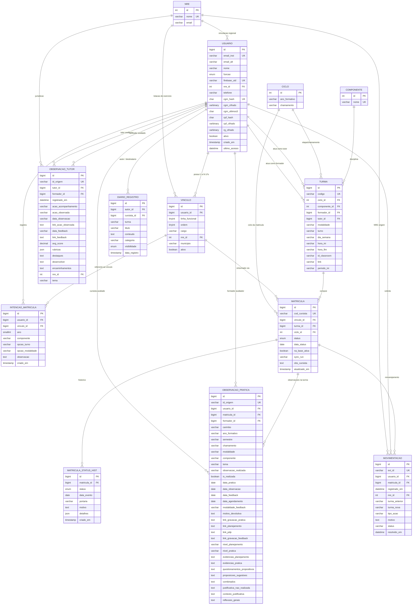
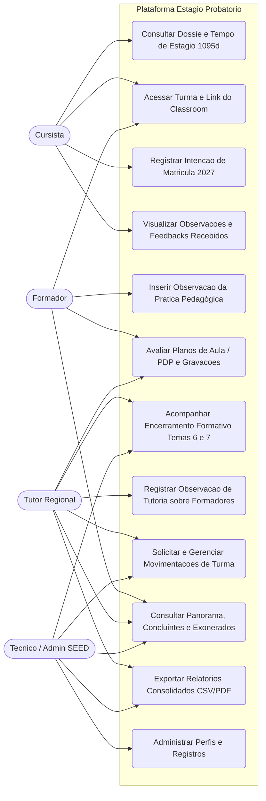
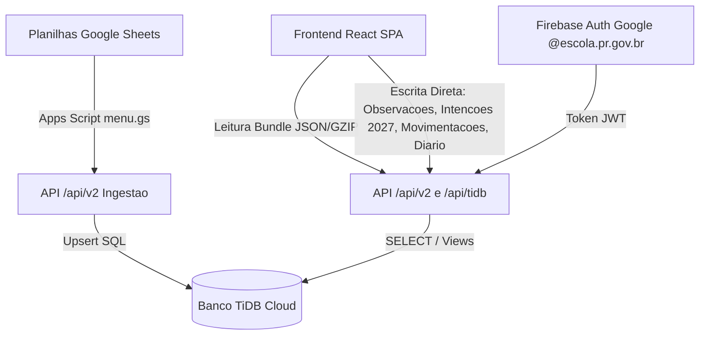

# DOCUMENTAÇÃO TÉCNICA E STATUS ATUAL DO PROJETO
## Plataforma de Gestão do Estágio Probatório Docente (SEED-PR)

**Repositório:** `https://github.com/estagioprobatorio/dashboard` (branch `main`)  
**URL Atual em Produção (Temporária):** `https://dashboard-tawny-delta-96.vercel.app`  
**Data de Referência:** 27 de Novembro de 2026  

---

## 1. Status Atual do Projeto (As-Is)

A plataforma encontra-se **em produção ativa** e atende atualmente toda a rede estadual do Paraná (32 Núcleos Regionais de Educação — NREs, mais de 8.000 professores cursistas em estágio probatório, formadores, tutores regionais e técnicos da SEED-PR).

### 1.1. Stack Tecnológica Atual
- **Frontend:** React 18 + Vite (`dist/` estático SPA), hospedado atualmente na Vercel.
- **Backend / API:** Funções Serverless Node.js (`api/v2.js`, `api/tidb.js`, `api/_lib/*`), utilizando `mysql2/promise` com compressão GZIP e cache HTTP.
- **Banco de Dados Atual:** TiDB Cloud Serverless (compatível com MySQL 8), seguindo o modelo relacional normalizado (`db/schema_v2.sql`).
- **Autenticação:** Firebase Authentication (Login Institucional Google Workspace `@escola.pr.gov.br`) com controle de acesso baseado em perfis (`superadmin`, `admin`, `tecnico`, `tutor`, `formador`, `cursista`).
- **Ingestão de Dados Cadastrais e Pedagógicos (Atual):** Realizada por meio de scripts Google Apps Script (`google-apps-script/menu.gs`) que extraem dados das Planilhas Google oficiais e os enviam via HTTP POST (`SYNC_TOKEN`) para a API `/api/v2`.
- **Escrita Direta no Banco (Atual):** Registros de observações manuais, intenções de matrícula 2027, solicitações de remanejamento e diário formativo são gravados diretamente pelo frontend via API no banco de dados.

### 1.2. Módulos Ativos em Produção
1. **Panorama Geral e Indicadores:** Visão consolidada por NRE, chamamento, ano formativo, modalidade e componente curricular.
2. **Ambiente do Cursista:** Acesso individual do docente em estágio probatório, histórico de turmas, contador de tempo de estágio probatório (1.095 dias / 156 semanas / 36 meses a partir da data de posse) e acesso ao Classroom.
3. **Dossiê do Cursista:** Visão 360° da vida funcional (Linhas Funcionais 1 e 2), histórico de observações e relatórios individuais.
4. **Observação da Prática Pedagógica (Formadores):** Registro e consulta das observações por tema (Temas 1 a 7), níveis de planejamento e prática, evidências, links de planos de aula / PDP, gravações de aula e feedback formativo.
5. **Encerramento Formativo (Tutores):** Painel específico para acompanhamento da implementação dos Temas 6 e 7 no 2º semestre, com filtros por tutor, formador, NRE do formador, cursista e status de preenchimento.
6. **Observações do Tutor (Tutor Insights):** Avaliação de tutores sobre a atuação dos formadores com rubricas ponderadas e encaminhamentos.
7. **Intenção de Matrícula 2027:** Formulário transacional com aceite de termo de ciência, escolha de turno/horário pretendido, atendimento especializado e geração de comprovante.
8. **Gestão de Turmas, Contatos e Movimentações:** Listagem de turmas, contatos de cursistas/formadores/tutores, remanejamentos, concluintes (1º chamamento) e exonerados.

---

## 2. Links das Planilhas Google Atualmente Utilizadas

Abaixo estão todas as planilhas Google Sheets atualmente conectadas ao sistema via Google Apps Script (`google-apps-script/menu.gs`):

| Finalidade | Identificador (Spreadsheet ID) | Link Oficial |
| :--- | :--- | :--- |
| **Planilha Mestra (Cursistas Ativos `DADOS`, `TURMAS`, `TUTORES`, `CONCLUINTES`, `EXONERADOS`, `NAO CONCLUINTES`, `MOVIMENTACOES`)** | `1sRkA88VrtczqXxQ6PlmgygeCVhPoElRNS8RC1QuQzx0` | https://docs.google.com/spreadsheets/d/1sRkA88VrtczqXxQ6PlmgygeCVhPoElRNS8RC1QuQzx0/edit |
| **Observações da Prática — 1º Ano (1º Semestre/2026)** | `1KmbMvNOTpj4OaDOdKw5mPVI3iqbo8RbQBqBktM84ToE` | https://docs.google.com/spreadsheets/d/1KmbMvNOTpj4OaDOdKw5mPVI3iqbo8RbQBqBktM84ToE/edit#gid=1030562032 |
| **Observações da Prática — 1º Ano (2º Semestre/2026)** | `1dL_Q-_15Idx3SNAZOqmKzrnVqA8tHFBzILA5PZ7p798` | https://docs.google.com/spreadsheets/d/1dL_Q-_15Idx3SNAZOqmKzrnVqA8tHFBzILA5PZ7p798/edit#gid=425616417 |
| **Observações da Prática — 2º e 3º Anos (1º Semestre/2026)** | `1zSnlh7aW8df800lP90rCLVxiHNWAa1f9IGjz2OoDfvU` | https://docs.google.com/spreadsheets/d/1zSnlh7aW8df800lP90rCLVxiHNWAa1f9IGjz2OoDfvU/edit#gid=848666482 |
| **Observações da Prática — 2º e 3º Anos (2º Semestre/2026)** | `1uv5QWeqtN5iMkH8nVQUvsYKClv9NaGDHgsdT_D-RPiw` | https://docs.google.com/spreadsheets/d/1uv5QWeqtN5iMkH8nVQUvsYKClv9NaGDHgsdT_D-RPiw/edit#gid=2068065207 |
| **Observações de Tutoria (Tutores → Formadores)** | `1V54Gl-KVGaHjLBH07hQZxq6GU88kfn0Xurh5P2LuSz8` | https://docs.google.com/spreadsheets/d/1V54Gl-KVGaHjLBH07hQZxq6GU88kfn0Xurh5P2LuSz8/edit |

---

## 3. Diagramas do Sistema

### 3.1. Diagrama Entidade-Relacionamento (DER)



### 3.2. Diagrama de Casos de Uso



### 3.3. Fluxo de Dados Atual (As-Is)



---

## 4. Estrutura do Frontend e Backend no Repositório

### 4.1. Estrutura de Arquivos do Frontend (`src/`)
- **`src/App.jsx`**: Núcleo da aplicação, controle de estado global, navegação por abas por perfil de usuário e normalização dos registros (`enrichedRecords`).
- **`src/config_roles.js` / `src/firebase.js`**: Configuração de autenticação Google e permissões por função.
- **`src/services/`**:
  - `tidbService.js`: Cliente HTTP responsável por todas as chamadas de leitura (`bundle`) e escrita (`observacao`, `intencao`, `movimentacao`, `diario`) à API.
  - `bundleLoader.js` / `bundleStorage.js`: Carregamento progressivo e cache local (`IndexedDB`) no navegador para reduzir tráfego de rede.
- **`src/components/`** (Principais Módulos Visuais):
  - `PaginaInicial.jsx`, `Panorama.jsx`, `PanoramaDetalheModal.jsx`: Visão gerencial e indicadores por NRE/etapa.
  - `AmbienteCursista.jsx`, `CardVidaFuncional.jsx`, `ContadorTempoEstagio.jsx`, `HistoricoTurmasCursista.jsx`: Painel do cursista e contagem de 1.095 dias de estágio probatório.
  - `DossieCursistaModal.jsx`, `BuscaGlobalPessoasModal.jsx`, `RadarCompetenciasCursista.jsx`, `CurvaEvolucaoPedagogica.jsx`: Dossiê completo do servidor.
  - `ObservacaoPratica.jsx`, `ObservacoesOverview.jsx`, `ObservacaoModalDetalhes.jsx`, `AcompanhamentoObservacoesCards.jsx`, `FormularioInserirObservacao.jsx`: Visualização e inserção de observações pedagógicas dos formadores.
  - `EncerramentoFormativo.jsx`: Painel de acompanhamento dos Temas 6 e 7 (2º Semestre) para tutores.
  - `TutorInsightsDashboard.jsx`, `DadosTutoria.jsx`, `FormularioChamadoTutor.jsx`: Observações de tutoria sobre formadores.
  - `IntencaoMatricula2027.jsx`, `PainelIntencaoVagasAdmin.jsx`, `TelaEncerramentoIntencao.jsx`: Pré-matrícula 2027.
  - `ListaTurmas.jsx`, `TurmaModal.jsx`, `ContatoCursistas.jsx`, `ContatoFormadores.jsx`: Gestão de turmas e contatos.
  - `Movimentacoes.jsx`, `FormularioRemanejamento.jsx`, `Concluintes.jsx`, `Exonerados.jsx`, `DiarioFormativo.jsx`, `CentralDocumentos.jsx`, `AdminPanel.jsx`.
- **`src/utils/`**: Utilitários de cálculo de datas (`tempoEstagioUtils.js`, `dateUtils.js`), normalização de NREs (`nreUtils.js`), componentes (`componenteUtils.js`), exportação CSV/impressão (`exportUtils.js`, `comprovanteIntencaoPrint.js`).

### 4.2. Estrutura da API (`api/`)
- **`api/v2.js`**: Endpoint principal da arquitetura v2 (autenticação via token Firebase, leitura do `bundle` filtrado por perfil/escopo, escrita de observações, intenções, movimentações e rotas de ingestão).
- **`api/tidb.js`**: Endpoint de consultas e operações compatíveis v1/v2.
- **`api/_lib/`**:
  - `db.js`: Pool de conexões MySQL/TiDB (`mysql2/promise`).
  - `auth.js`: Validação de token e resolução de perfil/escopo de acesso.
  - `bundle.js`: Montagem do pacote consolidado de dados retornado ao frontend (`buildBundle`).
  - `ingest.js`: Regras de upsert e validação de dados importados.
  - `crypto.js`: Criptografia AES-256-GCM e HMAC-SHA256 para CGM, CPF e RG.
  - `utils.js`: Sanitização de strings, datas, horários e normalização dos 32 NREs.

---

## 5. SQL Completo do Banco de Dados (`db/schema_v2.sql`)

```sql
-- =============================================================================
-- Estágio Probatório SEED/PR - Schema v2 (MySQL 8 / MariaDB 10.6+ / TiDB)
-- =============================================================================
SET NAMES utf8mb4;

CREATE TABLE IF NOT EXISTS nre (
  id    INT AUTO_INCREMENT PRIMARY KEY,
  nome  VARCHAR(80) NOT NULL UNIQUE,
  email VARCHAR(255) NULL
) ENGINE=InnoDB DEFAULT CHARSET=utf8mb4;

CREATE TABLE IF NOT EXISTS usuario (
  id            BIGINT AUTO_INCREMENT PRIMARY KEY,
  email_inst    VARCHAR(255) NULL UNIQUE,
  email_alt     VARCHAR(255) NULL,
  nome          VARCHAR(255) NOT NULL,
  funcao        ENUM('superadmin','admin','tecnico','tutor','formador','cursista') NOT NULL,
  firebase_uid  VARCHAR(128) NULL UNIQUE,
  nre_id        INT NULL,
  telefone      VARCHAR(40) NULL,
  cgm_hash      CHAR(64) NULL UNIQUE,
  cgm_cifrado   VARBINARY(255) NULL,
  cgm_ultimos3  CHAR(3) NULL,
  cpf_hash      CHAR(64) NULL,
  cpf_cifrado   VARBINARY(255) NULL,
  rg_cifrado    VARBINARY(255) NULL,
  ativo         BOOLEAN NOT NULL DEFAULT TRUE,
  criado_por    BIGINT NULL,
  criado_em     TIMESTAMP NOT NULL DEFAULT CURRENT_TIMESTAMP,
  ultimo_acesso DATETIME NULL,
  INDEX idx_usuario_funcao (funcao, ativo),
  INDEX idx_usuario_nre (nre_id),
  INDEX idx_usuario_nome (nome),
  INDEX idx_usuario_cgm (cgm_hash),
  CONSTRAINT fk_usuario_nre FOREIGN KEY (nre_id) REFERENCES nre(id)
) ENGINE=InnoDB DEFAULT CHARSET=utf8mb4;

CREATE TABLE IF NOT EXISTS vinculo (
  id              BIGINT AUTO_INCREMENT PRIMARY KEY,
  usuario_id      BIGINT NOT NULL,
  linha_funcional TINYINT NOT NULL DEFAULT 1,
  ordem           TINYINT NOT NULL DEFAULT 1,
  cargo           VARCHAR(100) NULL,
  nre_id          INT NULL,
  municipio       VARCHAR(120) NULL,
  ativo           BOOLEAN NOT NULL DEFAULT TRUE,
  UNIQUE KEY uq_vinculo_lf (usuario_id, linha_funcional),
  INDEX idx_vinculo_ordem (usuario_id, ordem),
  CONSTRAINT fk_vinculo_usuario FOREIGN KEY (usuario_id) REFERENCES usuario(id),
  CONSTRAINT fk_vinculo_nre FOREIGN KEY (nre_id) REFERENCES nre(id)
) ENGINE=InnoDB DEFAULT CHARSET=utf8mb4;

CREATE TABLE IF NOT EXISTS ciclo (
  id            INT AUTO_INCREMENT PRIMARY KEY,
  ano_formativo VARCHAR(20) NOT NULL,
  chamamento    VARCHAR(60) NOT NULL DEFAULT '',
  UNIQUE KEY uq_ciclo (ano_formativo, chamamento)
) ENGINE=InnoDB DEFAULT CHARSET=utf8mb4;

CREATE TABLE IF NOT EXISTS componente (
  id    INT AUTO_INCREMENT PRIMARY KEY,
  nome  VARCHAR(150) NOT NULL UNIQUE
) ENGINE=InnoDB DEFAULT CHARSET=utf8mb4;

CREATE TABLE IF NOT EXISTS turma (
  id            BIGINT AUTO_INCREMENT PRIMARY KEY,
  codigo        VARCHAR(120) NOT NULL UNIQUE,
  ciclo_id      INT NULL,
  componente_id INT NULL,
  formador_id   BIGINT NULL,
  tutor_id      BIGINT NULL,
  modalidade    VARCHAR(80) NULL,
  turno         VARCHAR(40) NULL,
  dia_semana    VARCHAR(40) NULL,
  hora_ini      VARCHAR(10) NULL,
  hora_fim      VARCHAR(10) NULL,
  id_classroom  VARCHAR(80) NULL,
  link          VARCHAR(500) NULL,
  periodo_ini   VARCHAR(40) NULL,
  INDEX idx_turma_tutor (tutor_id),
  INDEX idx_turma_formador (formador_id),
  CONSTRAINT fk_turma_ciclo FOREIGN KEY (ciclo_id) REFERENCES ciclo(id),
  CONSTRAINT fk_turma_comp FOREIGN KEY (componente_id) REFERENCES componente(id),
  CONSTRAINT fk_turma_formador FOREIGN KEY (formador_id) REFERENCES usuario(id),
  CONSTRAINT fk_turma_tutor FOREIGN KEY (tutor_id) REFERENCES usuario(id)
) ENGINE=InnoDB DEFAULT CHARSET=utf8mb4;

CREATE TABLE IF NOT EXISTS matricula (
  id               BIGINT AUTO_INCREMENT PRIMARY KEY,
  cod_cursista     VARCHAR(160) NULL UNIQUE,
  vinculo_id       BIGINT NOT NULL,
  turma_id         BIGINT NULL,
  ciclo_id         INT NULL,
  status           ENUM('ATIVA','CONCLUIDA','NAO_CONCLUIDA','EXONERADA','TRANSFERIDA') NOT NULL DEFAULT 'ATIVA',
  data_status      DATE NULL,
  na_base_ativa    BOOLEAN NOT NULL DEFAULT FALSE,
  sync_run         VARCHAR(40) NULL,
  obs_cursista     TEXT NULL,
  atualizado_em    TIMESTAMP NOT NULL DEFAULT CURRENT_TIMESTAMP ON UPDATE CURRENT_TIMESTAMP,
  UNIQUE KEY uq_matricula_turma (vinculo_id, turma_id),
  INDEX idx_mat_turma_status (turma_id, status),
  INDEX idx_mat_ativa (na_base_ativa),
  CONSTRAINT fk_mat_vinculo FOREIGN KEY (vinculo_id) REFERENCES vinculo(id),
  CONSTRAINT fk_mat_turma FOREIGN KEY (turma_id) REFERENCES turma(id),
  CONSTRAINT fk_mat_ciclo FOREIGN KEY (ciclo_id) REFERENCES ciclo(id)
) ENGINE=InnoDB DEFAULT CHARSET=utf8mb4;

CREATE TABLE IF NOT EXISTS matricula_status_hist (
  id           BIGINT AUTO_INCREMENT PRIMARY KEY,
  matricula_id BIGINT NOT NULL,
  status       ENUM('ATIVA','CONCLUIDA','NAO_CONCLUIDA','EXONERADA','TRANSFERIDA') NOT NULL,
  data_evento  DATE NULL,
  portaria     VARCHAR(100) NULL,
  motivo       TEXT NULL,
  detalhes     JSON NULL,
  criado_em    TIMESTAMP NOT NULL DEFAULT CURRENT_TIMESTAMP,
  UNIQUE KEY uq_hist (matricula_id, status),
  CONSTRAINT fk_hist_mat FOREIGN KEY (matricula_id) REFERENCES matricula(id) ON DELETE CASCADE
) ENGINE=InnoDB DEFAULT CHARSET=utf8mb4;

CREATE TABLE IF NOT EXISTS observacao_pratica (
  id                           BIGINT AUTO_INCREMENT PRIMARY KEY,
  id_origem                    VARCHAR(120) NULL UNIQUE,
  usuario_id                   BIGINT NULL,
  matricula_id                 BIGINT NULL,
  formador_id                  BIGINT NULL,
  carimbo                      VARCHAR(40) NULL,
  ano_formativo                VARCHAR(20) NULL,
  semestre                     VARCHAR(20) NULL,
  chamamento                   VARCHAR(60) NULL,
  modalidade                   VARCHAR(80) NULL,
  componente                   VARCHAR(150) NULL,
  tema                         VARCHAR(255) NULL,
  email_cursista               VARCHAR(255) NULL,
  nome_cursista                VARCHAR(255) NULL,
  email_formador               VARCHAR(255) NULL,
  nome_formador                VARCHAR(255) NULL,
  tutor_responsavel            VARCHAR(255) NULL,
  turma                        VARCHAR(160) NULL,
  nre_exe                      VARCHAR(100) NULL,
  munic_exe                    VARCHAR(120) NULL,
  proposta                     VARCHAR(100) NULL,
  observacao_realizada         VARCHAR(40) NULL,
  is_realizada                 BOOLEAN NULL,
  data_pratica                 DATE NULL,
  data_implementacao           DATE NULL,
  data_observacao              DATE NULL,
  data_feedback                DATE NULL,
  data_agendamento             DATE NULL,
  modalidade_feedback          VARCHAR(80) NULL,
  motivo_devolutiva            TEXT NULL,
  link_gravacao_pratica        TEXT NULL,
  link_planejamento            TEXT NULL,
  link_pdp                     TEXT NULL,
  proposta_pedagogica          TEXT NULL,
  link_gravacao_feedback       TEXT NULL,
  nivel_planejamento           VARCHAR(60) NULL,
  nivel_pratica                VARCHAR(60) NULL,
  evidencias_planejamento      TEXT NULL,
  evidencias_pratica           TEXT NULL,
  criterio1_nivel              VARCHAR(60) NULL,
  criterio1_evidencias         TEXT NULL,
  criterio2_nivel              VARCHAR(60) NULL,
  criterio2_evidencias         TEXT NULL,
  escala_boas_praticas         TEXT NULL,
  etapas_nao_realizadas        TEXT NULL,
  justificativa_etapas         TEXT NULL,
  questionamentos_propositivos TEXT NULL,
  proposicoes_sugestoes        TEXT NULL,
  combinados                   TEXT NULL,
  justificativa_nao_realizada  TEXT NULL,
  contexto_justificativa       TEXT NULL,
  reflexoes_gerais             TEXT NULL,
  quem_observou                VARCHAR(50) NULL,
  tutor_tecnico_observador     TEXT NULL,
  criado_em                    TIMESTAMP NOT NULL DEFAULT CURRENT_TIMESTAMP,
  INDEX idx_obs_usuario (usuario_id, data_observacao),
  INDEX idx_obs_matricula (matricula_id),
  CONSTRAINT fk_obs_usuario FOREIGN KEY (usuario_id) REFERENCES usuario(id),
  CONSTRAINT fk_obs_mat FOREIGN KEY (matricula_id) REFERENCES matricula(id),
  CONSTRAINT fk_obs_formador FOREIGN KEY (formador_id) REFERENCES usuario(id)
) ENGINE=InnoDB DEFAULT CHARSET=utf8mb4;

CREATE TABLE IF NOT EXISTS observacao_tutor (
  id                       BIGINT AUTO_INCREMENT PRIMARY KEY,
  id_origem                VARCHAR(100) NULL UNIQUE,
  tutor_id                 BIGINT NULL,
  formador_id              BIGINT NULL,
  registrado_em            DATETIME NULL,
  acao_acompanhamento      VARCHAR(255) NULL,
  acao_observada           VARCHAR(255) NULL,
  data_observacao          VARCHAR(50) NULL,
  link_acao_observada      TEXT NULL,
  data_feedback            VARCHAR(50) NULL,
  link_feedback            TEXT NULL,
  links_complementares     TEXT NULL,
  modalidade               VARCHAR(100) NULL,
  avg_score                DECIMAL(3,2) NULL,
  checklist_realizadas     TEXT NULL,
  checklist_nao_realizadas TEXT NULL,
  outros_registros         TEXT NULL,
  destaques                TEXT NULL,
  desenvolver              TEXT NULL,
  encaminhamentos          TEXT NULL,
  nre_id                   INT NULL,
  tema                     VARCHAR(255) NULL,
  rubricas                 JSON NULL,
  INDEX idx_obst_tutor (tutor_id),
  INDEX idx_obst_formador (formador_id),
  CONSTRAINT fk_obst_tutor FOREIGN KEY (tutor_id) REFERENCES usuario(id),
  CONSTRAINT fk_obst_formador FOREIGN KEY (formador_id) REFERENCES usuario(id),
  CONSTRAINT fk_obst_nre FOREIGN KEY (nre_id) REFERENCES nre(id)
) ENGINE=InnoDB DEFAULT CHARSET=utf8mb4;

CREATE TABLE IF NOT EXISTS movimentacao (
  id                   BIGINT AUTO_INCREMENT PRIMARY KEY,
  ext_id               VARCHAR(120) NULL UNIQUE,
  usuario_id           BIGINT NULL,
  matricula_id         BIGINT NULL,
  registrado_em        DATETIME NOT NULL DEFAULT CURRENT_TIMESTAMP,
  nre_id               INT NULL,
  tutor_responsavel    VARCHAR(255) NULL,
  email_tutor_resp     VARCHAR(255) NULL,
  turma_anterior       VARCHAR(160) NULL,
  turma_nova           VARCHAR(160) NULL,
  tipo_acao            VARCHAR(80) NULL,
  motivo               TEXT NULL,
  situacao_relacionada VARCHAR(120) NULL,
  ano_formacao         VARCHAR(20) NULL,
  chamamento           VARCHAR(60) NULL,
  modalidade_detalhes  TEXT NULL,
  turma_detalhes       TEXT NULL,
  justificativa        TEXT NULL,
  descricao            TEXT NULL,
  comprovante          TEXT NULL,
  status               VARCHAR(40) NOT NULL DEFAULT 'Pendente',
  nota_resolucao       TEXT NULL,
  solicitado_por       BIGINT NULL,
  solicitado_por_nome  VARCHAR(160) NULL,
  resolvido_por        BIGINT NULL,
  resolvido_em         DATETIME NULL,
  INDEX idx_mov_usuario (usuario_id),
  INDEX idx_mov_status (status, registrado_em),
  CONSTRAINT fk_mov_usuario FOREIGN KEY (usuario_id) REFERENCES usuario(id),
  CONSTRAINT fk_mov_mat FOREIGN KEY (matricula_id) REFERENCES matricula(id),
  CONSTRAINT fk_mov_nre FOREIGN KEY (nre_id) REFERENCES nre(id),
  CONSTRAINT fk_mov_solic FOREIGN KEY (solicitado_por) REFERENCES usuario(id),
  CONSTRAINT fk_mov_resolv FOREIGN KEY (resolvido_por) REFERENCES usuario(id)
) ENGINE=InnoDB DEFAULT CHARSET=utf8mb4;

CREATE TABLE IF NOT EXISTS diario_registro (
  id            BIGINT AUTO_INCREMENT PRIMARY KEY,
  autor_id      BIGINT NOT NULL,
  cursista_id   BIGINT NULL,
  turma         VARCHAR(160) NULL,
  titulo        VARCHAR(255) NOT NULL DEFAULT 'Registro Formativo',
  conteudo      TEXT NOT NULL,
  categoria     VARCHAR(80) NOT NULL DEFAULT 'Geral',
  visibilidade  ENUM('privado','equipe','publico') NOT NULL DEFAULT 'publico',
  data_registro TIMESTAMP NOT NULL DEFAULT CURRENT_TIMESTAMP,
  INDEX idx_diario_cursista (cursista_id, data_registro),
  CONSTRAINT fk_diario_autor FOREIGN KEY (autor_id) REFERENCES usuario(id),
  CONSTRAINT fk_diario_cursista FOREIGN KEY (cursista_id) REFERENCES usuario(id)
) ENGINE=InnoDB DEFAULT CHARSET=utf8mb4;

CREATE TABLE IF NOT EXISTS intencao_matricula (
  id               BIGINT AUTO_INCREMENT PRIMARY KEY,
  usuario_id       BIGINT NOT NULL,
  vinculo_id       BIGINT NULL,
  ano              SMALLINT NOT NULL DEFAULT 2027,
  componente       VARCHAR(150) NULL,
  opcao_turno      VARCHAR(60) NULL,
  opcao_modalidade VARCHAR(80) NULL,
  observacao       TEXT NULL,
  criado_em        TIMESTAMP NOT NULL DEFAULT CURRENT_TIMESTAMP,
  INDEX idx_int_usuario (usuario_id, ano),
  CONSTRAINT fk_int_usuario FOREIGN KEY (usuario_id) REFERENCES usuario(id),
  CONSTRAINT fk_int_vinculo FOREIGN KEY (vinculo_id) REFERENCES vinculo(id)
) ENGINE=InnoDB DEFAULT CHARSET=utf8mb4;

CREATE TABLE IF NOT EXISTS auditoria (
  id          BIGINT AUTO_INCREMENT PRIMARY KEY,
  usuario_id  BIGINT NULL,
  acao        VARCHAR(80) NOT NULL,
  entidade    VARCHAR(60) NULL,
  entidade_id VARCHAR(60) NULL,
  detalhes    JSON NULL,
  em          TIMESTAMP NOT NULL DEFAULT CURRENT_TIMESTAMP,
  INDEX idx_aud_em (em),
  INDEX idx_aud_usuario (usuario_id, em)
) ENGINE=InnoDB DEFAULT CHARSET=utf8mb4;

CREATE OR REPLACE VIEW v_cursista_turma AS
SELECT m.id AS matricula_id, m.cod_cursista, m.status, m.na_base_ativa,
       u.id AS usuario_id, u.nome AS nome_cursista, u.email_inst AS email, u.telefone AS telefone_cursista,
       u.cgm_ultimos3,
       v.id AS vinculo_id, v.linha_funcional, v.ordem, v.cargo, v.municipio AS munic_exe, nv.nome AS nre_exe,
       t.id AS turma_id, t.tutor_id, t.formador_id, t.codigo AS turma, c.nome AS componente, ci.ano_formativo, ci.chamamento,
       t.modalidade, t.turno, t.dia_semana, t.hora_ini, t.hora_fim, t.id_classroom, t.link,
       f.nome AS nome_formador, f.email_inst AS email_formador, f.telefone AS telefone_formador,
       tu.nome AS tutor_responsavel, tu.email_inst AS email_tutor, tu.telefone AS telefone_tutor,
       nt.nome AS nre_tutor
FROM matricula m
JOIN vinculo v ON v.id = m.vinculo_id
JOIN usuario u ON u.id = v.usuario_id
LEFT JOIN nre nv ON nv.id = v.nre_id
LEFT JOIN turma t ON t.id = m.turma_id
LEFT JOIN componente c ON c.id = t.componente_id
LEFT JOIN ciclo ci ON ci.id = COALESCE(m.ciclo_id, t.ciclo_id)
LEFT JOIN usuario f ON f.id = t.formador_id
LEFT JOIN usuario tu ON tu.id = t.tutor_id
LEFT JOIN nre nt ON nt.id = tu.nre_id;
```

---

## 6. Regras de Negócio Essenciais

1. **Identidade Única e Linhas Funcionais:** Cada servidor possui um único registro de `usuario` identificado pelo e-mail institucional (`@escola.pr.gov.br`) e CGM único, podendo possuir 1 ou 2 registros em `vinculo` (Linha Funcional 1 e Linha Funcional 2).
2. **Contagem de Tempo de Estágio Probatório:** Calculada no frontend (`src/utils/tempoEstagioUtils.js`) a partir da data de posse/início (`periodo_ini`), considerando o ciclo legal de **3 anos (1.095 dias / 156 semanas / 36 meses)** e emitindo alerta quando restam $\le 90$ dias.
3. **Filtro de Concluintes na Base Ativa:** Cursistas concluintes (1º chamamento) permanecem segregados no histórico (`CONCLUIDA`), não sendo contabilizados como cursistas ativos na base de enturmação vigente.
4. **Sigilo de Dados Pessoais (LGPD):** CGM, CPF e RG são protegidos em repouso (hash HMAC-SHA256 para busca e AES-256-GCM para cifragem), trafegando apenas máscaras (`cgm_ultimos3`) nas listagens gerais.
