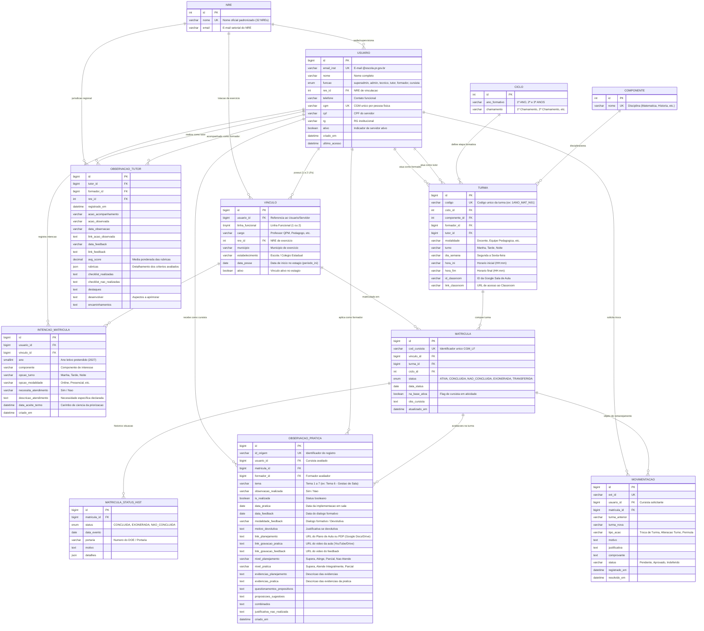

# ESPECIFICAÇÃO TÉCNICA DE DADOS, ARQUITETURA E DER
## Migração Institucional para Banco de Dados Interno (SEED-PR / CELEPAR / DTI)

**Projeto:** Sistema Integrado de Gestão do Estágio Probatório Docente  
**Órgão Solicitante:** Secretaria de Estado da Educação do Paraná (SEED-PR)  
**Destinatário:** Departamento de Tecnologia da Informação (DTI / SEED-PR) e CELEPAR  
**Data:** 27 de Novembro de 2026  
**Versão:** 2.0 - Arquitetura de Produção On-Premise  

---

## 1. Sumário Executivo e Objetivo da Solicitação

A plataforma de Gestão do Estágio Probatório da SEED-PR opera atualmente com um ecossistema frontend robusto em React/Vite, centralizando o acompanhamento formativo, dossiês funcionais, intenção de matrículas para 2027, observações pedagógicas e monitoramento de turmas de mais de 8.000 professores em estágio probatório.

Atualmente, a ingestão de dados depende de sincronização periódica a partir de planilhas de trabalho (Google Sheets). **O objetivo desta solicitação é:**

1. **Substituir o uso de planilhas por conexão direta com a base de dados institucional corporativa (CELEPAR / SEED-PR)** (ex.: Oracle Database, PostgreSQL corporativo ou MySQL/MariaDB institucional).
2. **Hospedar a aplicação e o backend em servidores próprios da SEED-PR**, sob domínio institucional próprio (exemplo: `https://estagioprobatorio.seed.pr.gov.br`).
3. **Manter integralmente o ecossistema Frontend atual**, desacoplando a camada de banco de dados do provedor em nuvem externa (TiDB Cloud) para o banco de dados oficial da SEED.
4. **Persistência nativa de dados transacionais internos:** Além de consumir os dados cadastrais e de lotação dos servidores (provenientes de sistemas legados da CELEPAR como SIGEP, RH Paraná / Meta4 e LRCO), a base de dados interna da SEED passará a gravar diretamente as **observações da prática pedagógica (formadores)**, as **observações de tutoria (tutores)**, as **solicitações de movimentação** e as **intenções de matrícula de 2027**.

---

## 2. Diagrama Entidade-Relacionamento (DER)

Abaixo está o modelo de dados relacional completo utilizado pela plataforma, estruturado para suportar tanto os dados importados dos sistemas corporativos da CELEPAR quanto os dados transacionais gerados pela equipe pedagógica.

---

## 3. Mapeamento das Fontes Institucionais de Dados (CELEPAR / SEED)

Abaixo descreve-se de quais sistemas corporativos da administração estadual os dados devem ser extraídos ou integrados via views/tabelas:

| Entidade / Conceito | Sistema de Origem (CELEPAR/SEED) | Descrição dos Campos Relevantes |
| :--- | :--- | :--- |
| **Identificação do Servidor** | **RH Paraná / Meta4** | Nome completo, CPF, RG, CGM (Cadastro Geral de Matrícula). |
| **Identidade Digital** | **Google Workspace SEED** | Conta institucional `@escola.pr.gov.br` (chave canônica de autenticação). |
| **Linhas Funcionais & Posse** | **RH Paraná / Meta4** | Linha Funcional (LF 1 ou 2), Padrão/Cargo, Regime de Trabalho (20h/40h), Data de Posse (`periodo_ini`), Data de Início de Exercício. |
| **Lotação & Exercício** | **SIGEP (Sist. Gestão Escolar)** | NRE de Exercício, Município de Exercício, Código e Nome do Estabelecimento de Ensino. |
| **Enturmação & Cursistas** | **LRCO / Sistema Estágio** | Chamamento (1º ou 2º), Ano Formativo (1º, 2º ou 3º Ano), Situação Funcional (Ativo, Concluinte, Exonerado). |
| **Formadores e Tutores** | **DEDI / Formação Continuada** | Atribuição de turmas, componentes curriculares e tutores regionais vinculados aos 32 NREs. |
| **Salas Virtuais** | **Google Classroom API** | Códigos e Links das turmas no Google Classroom. |

---

## 4. Dicionário de Dados das Tabelas Principais

### 4.1. Tabela `usuario` (Pessoas Físicas e Contas do Sistema)
Centraliza a identidade dos servidores da SEED que interagem com a plataforma.
- `id` (BIGINT, PK, Auto Increment): Identificador interno.
- `email_inst` (VARCHAR(255), UNIQUE, NOT NULL): E-mail `@escola.pr.gov.br` do servidor (chave primária lógica).
- `nome` (VARCHAR(255), NOT NULL): Nome completo em caixa alta.
- `funcao` (ENUM, NOT NULL): Papel no sistema (`cursista`, `formador`, `tutor`, `tecnico`, `admin`, `superadmin`).
- `nre_id` (INT, FK -> nre.id): NRE ao qual o usuário está subordinado.
- `telefone` (VARCHAR(40)): Telefone de contato (WhatsApp).
- `cgm` (VARCHAR(20), UNIQUE, NULL): Código Geral de Matrícula do servidor (único por pessoa física).
- `cpf` (VARCHAR(14), NULL): CPF do servidor.
- `ativo` (BOOLEAN, DEFAULT TRUE): Se o usuário está em exercício ou suspenso.

### 4.2. Tabela `vinculo` (Linhas Funcionais / Cargos)
Permite que o mesmo servidor (CGM único) possua até 2 Linhas Funcionais distintas (LF 1 e LF 2), por exemplo, dois padrões de 20 horas ou um padrão PSS/QPM.
- `id` (BIGINT, PK, Auto Increment)
- `usuario_id` (BIGINT, FK -> usuario.id, NOT NULL)
- `linha_funcional` (TINYINT, NOT NULL): Número da Linha Funcional (1 ou 2).
- `cargo` (VARCHAR(100)): Descrição funcional (ex.: "Professor - Ensino Fundamental e Médio", "Professor Pedagogo").
- `nre_id` (INT, FK -> nre.id): NRE do local de exercício da referida LF.
- `municipio` (VARCHAR(120)): Município de exercício.
- `estabelecimento` (VARCHAR(255)): Nome do Colégio Estadual de exercício.
- `data_posse` (DATE, NOT NULL): Data oficial de posse no concurso (`periodo_ini`). **Crucial para a contagem do tempo de estágio probatório.**

### 4.3. Regra de Negócio: Cálculo de Tempo em Estágio Probatório
A Lei Complementar estabelece o período de estágio probatório em **3 anos (1.095 dias corridos)**.
A partir do campo `data_posse` (`periodo_ini`) de cada vínculo:
$$\text{Dias Cumpridos} = \text{Data Atual} - \text{Data de Posse}$$
$$\text{Progresso (\%)} = \min\left(100, \frac{\text{Dias Cumpridos}}{1095} \times 100\right)$$
- **Fase Conclusiva (Alerta dos 90 Dias):** Quando restam $\le 90$ dias para atingir os 1.095 dias, a plataforma emite alerta visual nos relatórios para aceleração da comissão de avaliação especial de desempenho.

### 4.4. Tabela `turma` (Ofertas Formativas)
Representa as salas formativas ativas no semestre.
- `id` (BIGINT, PK, Auto Increment)
- `codigo` (VARCHAR(120), UNIQUE, NOT NULL): Código da turma (ex.: `1ANO_DOC_MAT_NOITE_01`).
- `ciclo_id` (INT, FK -> ciclo.id): Etapa formativa (1º Ano, 2º e 3º Anos) e chamamento.
- `componente_id` (INT, FK -> componente.id): Disciplina ou área.
- `formador_id` (BIGINT, FK -> usuario.id): Docente formador responsável.
- `tutor_id` (BIGINT, FK -> usuario.id): Tutor regional de acompanhamento.
- `modalidade` (VARCHAR(80)): Docentes, Equipe Pedagógica ou Técnicos.
- `turno` (VARCHAR(40)): Manhã, Tarde ou Noite.
- `dia_semana` (VARCHAR(40)): Dia do encontro semanal síncrono.
- `hora_ini` / `hora_fim` (VARCHAR(10)): Horários oficiais no formato `HH:mm`.
- `id_classroom` / `link`: Identificadores da sala de aula no Google Classroom.

### 4.5. Tabela `observacao_pratica` (Avaliações dos Cursistas pelos Formadores)
Armazena a implementação dos Temas 1 a 7, feedbacks pedagógicos, gravações e planos de aula.
- `id` (BIGINT, PK, Auto Increment)
- `id_origem` (VARCHAR(120), UNIQUE): Chave determinística da resposta.
- `usuario_id` (BIGINT, FK -> usuario.id): Cursista avaliado.
- `formador_id` (BIGINT, FK -> usuario.id): Formador que realizou a observação.
- `matricula_id` (BIGINT, FK -> matricula.id, NULL).
- `tema` (VARCHAR(255), NOT NULL): Tema pedagógico (ex.: "Tema 6: Referência 4 - Programas de Educação Digital", "Tema 7: Referência 5 - Avaliação Interna").
- `is_realizada` (BOOLEAN): Se a prática foi efetivamente realizada ou justificada como não realizada.
- `data_pratica` (DATE): Data da aula em que a prática foi executada.
- `data_feedback` (DATE): Data em que o formador realizou a reunião devolutiva.
- `modalidade_feedback` (VARCHAR(80)): "Diálogo formativo" (síncrono) ou "Devolutiva" (assíncrona).
- `motivo_devolutiva` (TEXT): Justificativa obrigatória caso não tenha ocorrido diálogo síncrono.
- `link_planejamento` (TEXT): **URL oficial do Plano de Aula ou PDP (Google Docs / Google Drive).**
- `link_gravacao_pratica` (TEXT): URL do vídeo da aula gravada (YouTube institucional ou Drive).
- `link_gravacao_feedback` (TEXT): URL do vídeo da reunião devolutiva gravada.
- `nivel_planejamento` (VARCHAR(60)): Nível atribuído ao planejamento (Supera, Atinge, Parcial, Não Atende).
- `nivel_pratica` (VARCHAR(60)): Nível atribuído à regência de aula.
- `evidencias_planejamento` / `evidencias_pratica` (TEXT): Evidências pedagógicas descritas pelo formador.
- `questionamentos_propositivos` / `proposicoes_sugestoes` / `combinados` (TEXT): Encaminhamentos pactuados.

### 4.6. Tabela `observacao_tutor` (Monitoramento dos Formadores pelos Tutores)
Armazena o acompanhamento e as rubricas de qualidade pedagógica registradas pelos tutores regionais.
- `id` (BIGINT, PK, Auto Increment)
- `tutor_id` (BIGINT, FK -> usuario.id): Tutor responsável pela observação.
- `formador_id` (BIGINT, FK -> usuario.id): Formador acompanhado.
- `nre_id` (INT, FK -> nre.id): Núcleo Regional de Educação.
- `registrado_em` (DATETIME): Data e hora do registro.
- `acao_acompanhamento` (VARCHAR(255)): Tipo de ação observada.
- `avg_score` (DECIMAL(3,2)): Média das rubricas avaliativas.
- `rubricas` (JSON): Estrutura com critérios pedagógicos pontuados.
- `destaques` / `desenvolver` / `encaminhamentos` (TEXT): Orientações emitidas pelo tutor ao formador.

### 4.7. Tabela `intencao_matricula` (Pré-Inscrição e Alocação de Turmas 2027)
Registros dos cursistas sobre suas preferências de turno e necessidades especiais para o próximo ciclo formativo.
- `id` (BIGINT, PK, Auto Increment)
- `usuario_id` (BIGINT, FK -> usuario.id): Cursista.
- `vinculo_id` (BIGINT, FK -> vinculo.id): Linha funcional associada à intenção.
- `ano` (SMALLINT, DEFAULT 2027): Ano letivo pretendido.
- `componente` (VARCHAR(150)): Componente curricular prioritário.
- `opcao_turno` (VARCHAR(60)): Manhã, Tarde ou Noite.
- `opcao_modalidade` (VARCHAR(80)): Presencial / Síncrono / Remoto.
- `necessita_atendimento` (VARCHAR(10)): "Sim" ou "Não" para atendimento especializado.
- `descricao_atendimento` (TEXT): Descrição de adaptação curricular ou acessibilidade informada pelo servidor.
- `data_aceite_termo` (DATETIME): Registro eletrônico de ciência das diretrizes de suprimento de aulas da SEED.

---

## 5. Requisitos de Infraestrutura e Implantação On-Premise (DTI / SEED)

Para hospedar a plataforma na infraestrutura oficial da SEED-PR mantendo o frontend React existente:

1. **Servidor Web / Proxy Reverso:**
   - **Ambiente:** Servidor Linux institucional (Debian/Ubuntu Server ou Red Hat Enterprise Linux).
   - **Web Server:** Nginx ou Apache com terminação SSL/TLS corporativo para o domínio institucional (ex: `https://estagioprobatorio.seed.pr.gov.br`).
   - **Frontend:** Build estático de alta performance (`dist/` gerado via Vite), servido diretamente pelo Nginx com suporte a gzip/brotli e rotas SPA (`try_files $uri $uri/ /index.html;`).

2. **Serviço de Backend / API REST:**
   - **Runtime:** Node.js (v20+ LTS) ou contêiner Docker oficial.
   - **Mecanismo de Conexão:** Pool de conexões (ex: biblioteca `mysql2/promise` ou `pg` / `oracledb`) apontando para a instância interna do banco corporativo disponibilizado pela DTI/CELEPAR.
   - **Autenticação Institucional:** Suporte a SSO (Single Sign-On) via Google Workspace da SEED (`@escola.pr.gov.br`) ou LDAP/Active Directory corporativo do Estado do Paraná.

3. **Opções de Integração com o Banco pela DTI (Qualquer uma das opções atende a plataforma):**
   - **Opção 1 (Recomendada):** Criação de uma base de dados relacional dedicada (PostgreSQL ou MySQL/MariaDB) com replicação/views automáticas dos sistemas CELEPAR (RH Paraná/SIGEP) e concessão de acesso de leitura e escrita para as tabelas transacionais (`observacao_pratica`, `observacao_tutor`, `intencao_matricula`, `movimentacao`).
   - **Opção 2:** Provisionamento de Views SQL de leitura sobre as tabelas do Meta4/SIGEP + Tabelas de escrita locais no banco corporativo da SEED.
   - **Opção 3:** Disponibilização de APIs REST internas corporativas (ex.: API Gateway CELEPAR) com as rotas equivalentes às especificadas neste documento.

---

## 6. Links Externos dos Planos de Aula e Vídeos: Diretriz de Acesso

Um apontamento fundamental para a equipe de tecnologia e pedagógica diz respeito ao compartilhamento dos anexos:
- Os **Planos de Aula (Google Docs)** e as **Gravações das Práticas (YouTube/Drive)** são inseridos pelos formadores no formulário institucional.
- A plataforma trata e sanitiza automaticamente todas as URLs, garantindo o protocolo `https://` e eliminando espaçamentos indevidos.
- Como política de governança do Google Workspace da SEED-PR, todos os arquivos criados com e-mails `@escola.pr.gov.br` exigem que o usuário que está acessando o link esteja conectado na sua respectiva conta institucional.
- Na arquitetura definitiva com a DTI, os planos de aula poderão também ser armazenados diretamente em repositório institucional de arquivos (Storage S3 local / MinIO / pasta de rede segura da SEED), eliminando a dependência do Google Docs.
